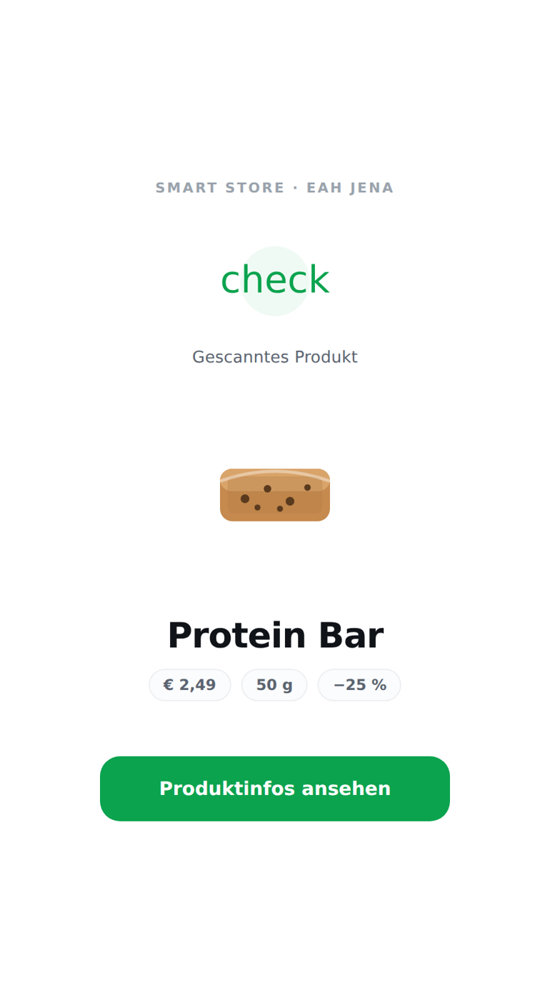
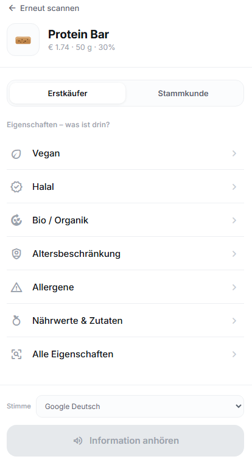
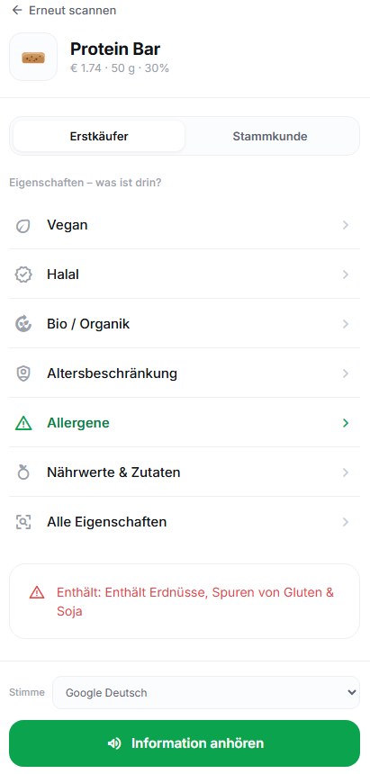
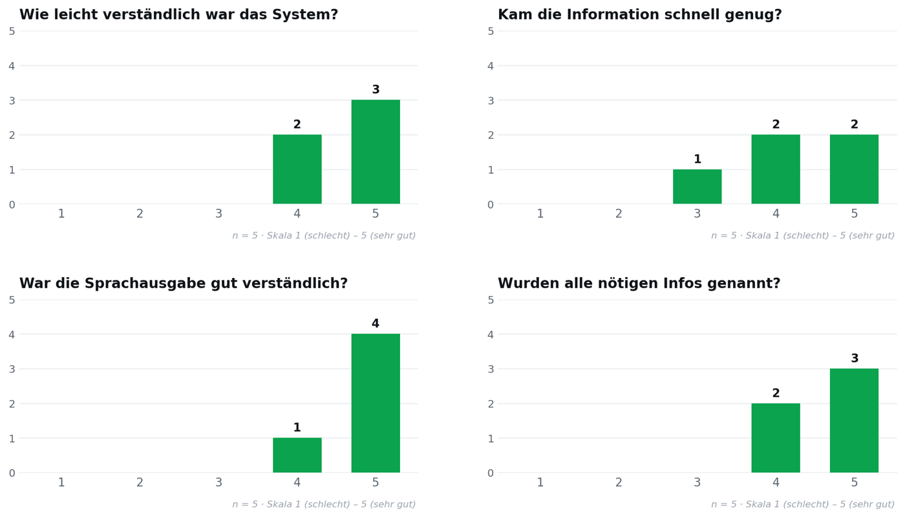

# 🔊 Talking Label – Audio Product Information in the Smart Store

> **Omni-Commerce · Accessibility · Web Speech API · Design Science Research**

You stand in front of a shelf and find an interesting product – but the electronic shelf label (ESL) only shows **name, price and size**. Is it vegan? Halal? Does it contain nuts? When does it expire? **Talking Label** closes this gap: scan the QR code on the ESL with your phone camera, choose what you want to know, and the answer is **read aloud in German** – no app, no download, no staff needed.

**▶ Live demo:** [Protein Bar](https://omnilabel.netlify.app/?produkt=protein) · [Snack Bar](https://omnilabel.netlify.app/?produkt=snack)

*Omni-Commerce research project, summer semester 2026, EAH Jena · Supervisor: Prof. Dr. Andrej Werner*

<p>
  
</p>

---

## 🧩 Problem

> *"The cafeteria is full. I quickly need a protein bar – but I'm vegan. The label only shows the price. Is it vegan? Does it contain nuts? There's nobody to ask."*
> → Unsure, and in the end buys nothing.

The ESL in the smart store lacks allergens, vegan/halal status, nutrition facts and ingredients, best-before date and organic certification. The QR code that is already printed on the label leads nowhere useful.

---

## 🎯 Goal

A system that gives customers **instant access to all relevant product information via the QR code on the shelf – as audio, without an app and without staff.**

- Close the information gap at the shelf
- Enable self-service
- Accessibility through audio (visually impaired and older customers)
- Realistic and immediately testable

---

## 💡 Solution: Scan. Choose. Listen.

| Step | What happens |
|---|---|
| **1 · Scan** | QR code with the phone camera, opens the web page directly |
| **2 · Choose** | Pick a preference: vegan, halal, allergens, nutrition, best-before date … |
| **3 · Listen** | The answer is shown as text and read aloud in German |

**Two user groups** with different information needs:

| First-time buyer – *"What's inside?"* | Regular customer – *"Just a quick check"* |
|---|---|
| Vegan · Halal · Organic | Best-before date & batch |
| Age restriction | Disposal & recycling |
| Allergens | Ratings |
| Nutrition facts & ingredients | |

<p>
  
  
  
</p>

---

## 🗂️ Data maintenance via Google Sheets

The store staff maintain product data in a **Google Sheet – no programming needed**. The page reads the sheet as CSV ("Publish to web") on every visit; if the sheet is unreachable, the built-in data is used, so the prototype also works offline.

| Column | Example |
|---|---|
| `produkt` | `protein` (matches `?produkt=` in the QR link) |
| `name`, `size` | Protein Bar, 50 g |
| `preis`, `neue preis`, `rabatt` | 2,49 · 1,87 · −25 % |
| `vegan`, `halal`, `bio` | ja / nein |
| `allergene`, `naehrwerte` | free text |
| `verfallsdatum`, `entsorgung`, `rating` | free text |

The **QR code never changes** – only the sheet is edited, e.g. to update a price or discount.

---

## 🛠️ Tech Stack


- Single HTML file, no framework, no build step
- `SpeechSynthesis` with automatic selection of the best available German voice (selectable by the user)
- Product chosen via URL parameter `?produkt=protein|snack`
- Hosted on Netlify

---

## 🔬 Method & Evaluation

**Design Science Research** (Hevner et al., 2004): problem analysis (observation, ESL documentation) → prototype (QR + Web Speech API) → evaluation → refinement based on feedback.

Five students tested the prototype and rated it on a scale from 1 (poor) to 5 (very good):

| Question | Ratings | Mean |
|---|---|---|
| How easy to understand was the system? | 4, 4, 5, 5, 5 | **4.6** |
| Was the information fast enough? | 3, 4, 4, 5, 5 | **4.2** |
| Was the speech output easy to understand? | 4, 5, 5, 5, 5 | **4.8** |
| Was all necessary information provided? | 4, 4, 5, 5, 5 | **4.6** |

<p></p>

- 🗣️ The **speech output** was rated best (4.8).
- ⏱️ **Speed** was the weakest point (4.2): the next iteration should shorten the path to the answer.

---

## ⚠️ Limitations

- Small test group (n = 5 students), so the results are indicative only.
- Product data is **demo data** for two sample products.
- Voice quality depends on the voices installed on the user's device.

## 🔭 Next Steps

1. **Integration with a real ESL:** link the QR code on the shelf to the live page
2. **Larger usability test:** more participants, measure time, decision confidence and satisfaction
3. **Better speech quality:** optional AI-based text-to-speech for a more natural voice

---

## 📁 Project Structure

```
talking-label/
├── index.html              # Complete prototype (UI, product data, Sheets loader, speech output)
├── assets/
│   ├── esl-protein-bar.jpg # Electronic shelf label with QR code
│   └── qr/                 # QR codes for both demo products
└── docs/                   # Screenshots and evaluation chart
```

**Run locally:** open `index.html` in a browser (Chrome or Safari for the best German voices), or add `?produkt=snack` to the URL.

---

## 💡 What I Learned

- Starting from a **real, observed problem** instead of a technology looking for a use case
- **Simplicity over complexity:** an earlier WebAR concept was dropped in favour of a solution customers can use in seconds
- Designing for **graceful degradation** (built-in data when the sheet is unreachable)
- Evaluating a prototype with users and turning feedback into concrete next steps
